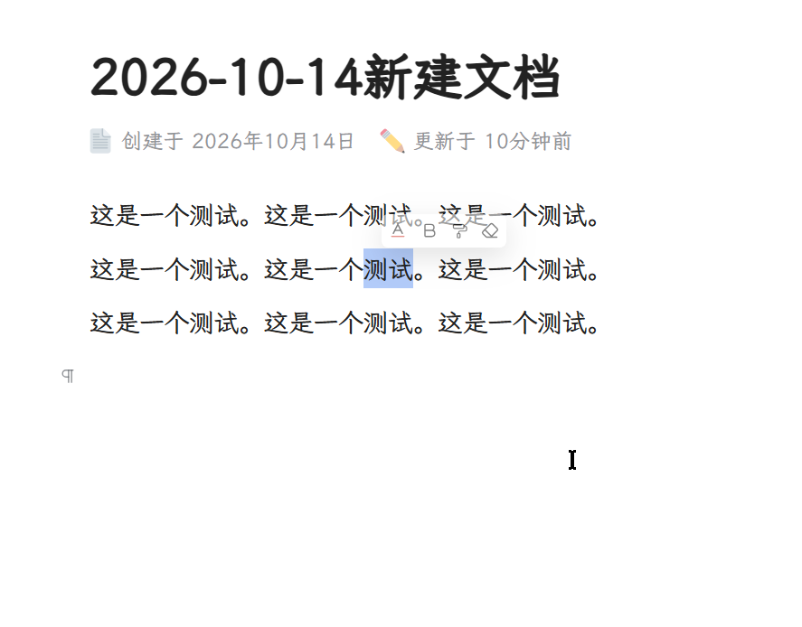

# Toolbar Fade

[中文说明](./README.md)

A [SiYuan](https://github.com/siyuan-note/siyuan) plugin: the popup toolbar that appears when you
select text **fades out as the mouse moves away and closes immediately past a configurable distance**
— close to how Word's floating toolbar behaves.

SiYuan's native behaviour is that the toolbar stays on screen until you click elsewhere or select
something new. This plugin makes it follow your mouse instead: it never gets in the way while you're
using it, and steps aside once you've moved on.

## Behaviour

With the defaults (20px / 200px):

```
Select text              → the toolbar appears, fully opaque (the mouse is right there)
Mouse within 20px        → still fully opaque
Mouse beyond 20px        → fades linearly with distance
At 200px away            → still visible, but clearly faint (opacity ≈ 0.4)
Beyond 200px             → closed immediately, no delay, no lingering animation
Mouse comes back         → fully opaque again, buttons clickable as usual
After it closed          → moving the mouse does not bring it back (select text again)
```

Opacity by distance:

| Distance | 20px | 65px | 110px | 155px | 200px | >200px |
| --- | --- | --- | --- | --- | --- | --- |
| Toolbar opacity | 1 | 0.85 | 0.70 | 0.55 | 0.40 | closed |



## Installation

**From the bazaar (recommended)**

`Settings → Bazaar → Download`, search for "Toolbar Fade", install and enable it.

**Manually**

Copy these files into `<workspace>/data/plugins/plugin-toolbar-fade/`:

```
plugin.json      ← required
index.js         ← required (build output, don't edit by hand)
icon.png
index.css
preview.png
i18n/            ← zh-CN.json / en.json
README.md
README.en.md
```

Put the folder itself under `plugins/` — don't nest it one level deeper
(`plugins/plugin-toolbar-fade/plugin.json` is the right layout). `src/` holds the sources; it isn't
needed at runtime.

Alternatively, download `package.zip` from the latest Release and extract it into
`data/plugins/plugin-toolbar-fade/`.

## Settings

`Settings → Bazaar → Downloaded → Toolbar Fade → Settings` (no top-bar icon is used).

| Option | Default | Meaning |
| --- | --- | --- |
| Enable distance fade | on | Master switch; when off, SiYuan's native behaviour is restored |
| Fade starts beyond | 20 px | Fully opaque within this distance, fainter the farther away |
| Close immediately beyond | 200 px | The toolbar is closed as soon as the mouse goes past this |

Only those two distances are configurable. "Delay before fading" and "fade duration" are deliberately
not settings: fading is a continuous function of distance, and closing happens the moment the
distance is exceeded, so neither needs a timing knob.

The measured distance is **the shorter of** the distance to the toolbar and the distance to the
current selection. So the mouse resting on the selected text, or on the toolbar itself, counts as
distance 0 and the toolbar stays fully opaque.

## How it works

The SiYuan toolbar is plain DOM, not a native window:

- every editor pane has its own `div.protyle-toolbar` (`position: fixed`, `z-index: 7`), mounted
  inside the `.protyle` element and **not** recreated when the selection changes;
- it is shown/hidden purely by toggling the class `fn__none`, which is defined as
  `display: none !important`;
- SiYuan has **no** mouse-move or idle-timer logic for it. The only mouse-driven hide happens on
  `mousedown` outside the toolbar.

So pure CSS cannot do this (CSS has no idea where the mouse is). The plugin instead:

1. watches the toolbar's `class` / `style` with a `MutationObserver` to detect "it just appeared";
2. listens to `mousemove` / `scroll` / `mouseup` on `document` in the capture phase (`passive`, so
   scrolling is never blocked) and computes the mouse-to-toolbar/selection distance, throttled
   through `requestAnimationFrame`;
3. maps that distance to an opacity between 0.4 and 1 and writes it to the toolbar's **inline**
   `opacity` (CSS only provides a 0.18s transition so the change looks smooth);
4. past the close distance, adds `fn__none` **immediately** — the very same class SiYuan itself uses
   to hide the toolbar. No private API is involved.

Pitfalls handled (all commented in `src/index.js`):

- **Never disable the toolbar's pointer events.** `.protyle-toolbar` is the parent of its buttons;
  `pointer-events: none` there breaks the whole toolbar — the cursor turns into the editor's I-beam
  and clicks fall through to the document.
- **Clear the inline `display` before closing**: SiYuan's scroll handler writes
  `toolbar.element.style.display = "none"` when the selection scrolls out of view. The plugin clears
  it before adding `fn__none` (SiYuan's own `hideElements` does the same), otherwise the toolbar can
  never be shown again.
- **Do nothing if the mouse never came close**: selecting with `Shift+Arrow` while the mouse rests
  elsewhere must not make the toolbar vanish instantly.
- **Re-evaluate the armed state every frame**: deciding only when the toolbar appears would leave
  toolbars that already existed at plugin load permanently unmanaged.
- **Stop tracking after closing**: once closed, mouse movement never brings it back — you select
  text again when you want it.
- **The loop stops**: the `requestAnimationFrame` loop halts as soon as the toolbar is closed,
  hidden, or the feature is switched off, so it never spins.

## Known limitations

- It relies on SiYuan's class names (`.protyle-toolbar`, `fn__none`). A future major version renaming
  them would require an update — a shared risk for all plugins of this kind. The plugin does **not**
  modify SiYuan itself and uninstalling restores the native behaviour completely.
- Only the text-selection toolbar is handled. The sub-panel (`.protyle-util`, e.g. colour/font) does
  not fade, but it is opened from a toolbar button, so the mouse is on the toolbar anyway.
- Some SiYuan versions rebuild the toolbar buttons (rewriting `innerHTML`). The plugin injects no
  nodes into the toolbar, so it is unaffected.

## Development

```
index.js         ← build output (what SiYuan actually loads; don't edit)
src/index.js     ← real source (native ESM, easier to maintain)
i18n/            ← zh-CN.json / en.json
tools/           ← build, pack, preflight, offline tests, icon/preview generators
```

After editing `src/index.js` or `index.css` you must re-bundle the entry and rebuild
`package.zip`:

```bash
npm run build       # src/index.js → index.js
npm test            # offline tests (20 assertions)
npm run pack        # build package.zip for a Release
npm run preflight   # check against the bazaar rules
npm run release     # all of the above in one go
```

See [DEVELOPMENT.md](./DEVELOPMENT.md) (Chinese) for details.

### Why the entry must be bundled

SiYuan loads plugins with **`eval` + CommonJS** (see the `Pe` function in `stage/build/app/common.*.js`):

```js
window.eval("(function anonymous(require, module, exports){" + source + "\n})")(require, module, exports)
const ct = (module.exports || {}).default || module.exports
if (typeof ct != "function")            → "has no export"
if (!(ct.prototype instanceof Plugin))  → "does not extends Plugin"
```

Therefore the plugin source must not contain `import` / `export` (that throws
`SyntaxError: Cannot use import statement outside a module` inside `eval`, and the plugin silently
does nothing with no settings entry), and it must hand the plugin class over via `module.exports`,
extending `siyuan.Plugin`. `siyuan` is supplied by the host as `require("siyuan")`.

The bundler does exactly that rewrite; the plugin has no other dependency, so no full bundler
is needed. The offline tests load the built file through the same `eval`/CJS protocol, so an
accidental `import` or a missing `module.exports` fails the tests immediately.

## Publishing

See [PUBLISH.md](./PUBLISH.md) (Chinese): create the GitHub repo, tag a Release with `package.zip`,
then open a PR adding the repo to `siyuan-note/bazaar`.

## License

[MIT](./LICENSE)
